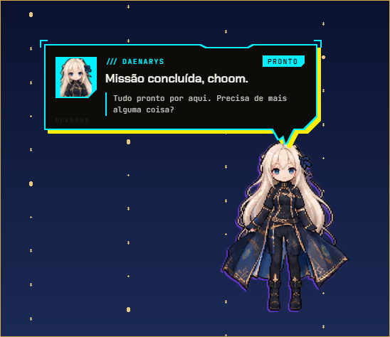

# Daenarys Assistente (pt-BR)

Assistente de desktop para Windows baseada na **Daenarys** (Electron/JS), com voz em português do Brasil,
comandos reais no PC, IA (Gemini, Groq e Ollama), notícias e bandeja com atalho global.

Este projeto vive ao lado do antigo `assistente_pc` (Python), que continua intacto. A voz e as notícias
usam um **motor Python local** (`engine/`) iniciado escondido pelo Electron; o resto é a Daenarys.
A arte da personagem vem da folha de referência em `tools/daenarys-sheet.png`, processada por
`tools/build-daenarys.py`.



---

## Baixar e instalar

Baixe o app pronto na página de releases:

**https://github.com/felipe2026raji-hue/daenarys-assistente/releases/latest**

Na seção **Assets** da release:

| Arquivo | Para quê |
|---|---|
| `Daenarys-Setup-<versão>.exe` | Instala no PC (atalho na área de trabalho, desinstalador). Recomendado. |
| `Daenarys-Portable-<versão>.exe` | Roda sem instalar; extrai para uma pasta temporária. |
| `SHA256SUMS.txt` | Confere a integridade do download. |

1. Baixe o `.exe`.
2. Execute. Se o Windows mostrar “O Windows protegeu o computador”, clique em **Mais informações → Executar assim mesmo** (o instalador ainda não tem assinatura digital).
3. Pronto: a Daenarys sobe o motor de voz/notícias sozinha. **Não precisa de Python.**

> **Source code (zip/tar.gz)** é só o código-fonte, não o app. Para usar, baixe os `.exe` em **Assets**.

Para conferir o download:

```powershell
Get-FileHash .\Daenarys-Setup-0.5.1.exe -Algorithm SHA256
```

Compare com a linha correspondente do `SHA256SUMS.txt`.

---

## O que ela faz

| Recurso | Como funciona |
|---|---|
| **Falar** | Tudo o que ela diz é lido em voz alta com `edge-tts`, na voz do idioma escolhido: `pt-BR-ThalitaMultilingualNeural`, `en-US-AriaNeural`, `es-ES-ElviraNeural`, `fr-FR-DeniseNeural` ou `ru-RU-SvetlanaNeural`. Sem internet, cai para a voz do Windows daquele idioma (se estiver instalada). |
| **Ouvir** | Escuta contínua com a palavra de ativação **“Daenarys”**: diga “Daenarys, abre o Chrome”. O reconhecimento acompanha o idioma do app (pt-BR, en-US, es-ES, fr-FR, ru-RU). Depois de cada resposta falada, ela continua ouvindo por 12 segundos, sem repetir o nome (modo conversa). Também pelo botão do microfone ou `Ctrl+Alt+J`. |
| **Comandos do PC** | Abre apps e pastas por nome ou caminho, controla volume, tema e janelas, apaga a tela, suspende, hiberna, bloqueia, desliga e reinicia. |
| **IA** | Gemini, Groq, Ollama e outros provedores já suportados pela Daenarys. Chaves em `Chave de API ou endereço…`. |
| **Notícias** | Manchetes de Google Notícias, Agência Brasil e BBC Brasil; lidas na abertura e pelo menu. |
| **Personalidade** | Fala natural de gente, com humor e fantasia dosada (dragão, lua, cometa, feitiço) — sem vícios de robô como “Claro!”, “Como posso ajudar?” ou listas. Memória e vínculo da Daenarys, em português. |
| **Interatividade** | Modo conversa, iniciativa própria, memória viva e brincadeiras de fantasia — veja abaixo. |
| **Bandeja e atalho** | Ícone na bandeja e `Ctrl+Alt+C` para esconder/mostrar. |
| **Atualizações** | Ao abrir, ela procura uma versão nova nas releases do GitHub e baixa em segundo plano; o menu passa a mostrar **Reiniciar e atualizar**. Dá para desligar em **Mais opções → Atualizar sozinha**. A versão portátil não se atualiza sozinha: baixe o `.exe` novo. |

> **Voz no idioma dela:** o idioma escolhido em **Mais opções → Idioma** vale para o que ela fala e para o que ela ouve. A voz neural precisa de internet; sem conexão, ela usa a voz do Windows — para os cinco idiomas, instale as vozes em **Windows → Configurações → Hora e idioma → Fala**.

### Controle do PC por voz ou texto

Diga (ou escreva) o que quer; ela executa e fala o que fez:

- **Pastas**: “abre a pasta Downloads”, “abre a pasta Projetos”, “abre C:\Users\User\Documents”, “abre %USERPROFILE%\Desktop”.
- **Energia**: “bloqueia o PC”, “suspende”, “hiberna”, “apaga a tela” ou “coloca em tela de descanso”, “desliga o PC”, “reinicia o PC”, “desliga o PC em 1 hora”.
- **Cancelar**: “cancela o desligamento” (o desligamento e o reinício têm uma contagem de 30 segundos, ou o tempo pedido).
- **Volume, tema, janelas e informações**: “som em 30%”, “modo escuro”, “range as janelas”, “quanta bateria?”, “quanto espaço livre?”.

O bloqueio, a suspensão, a hibernação e a tela apagada acontecem na hora; o desligamento e o reinício começam com a contagem, para dar tempo de cancelar.

### Conversa e brincadeiras

- **Modo conversa**: depois que ela responde em voz alta, a escuta continua aberta por 12 segundos. Você fala de novo sem repetir “Daenarys”. Desligue em **Ajustes rápidos › Continuar a conversa**.
- **Ela puxa assunto**: de vez em quando ela comenta a madrugada, uma sessão longa, muitas janelas abertas, o silêncio ou algo que você contou. Tem cooldown de 28–55 minutos e nunca acontece durante o chat. Desligue em **Ela puxa assunto**.
- **Memória viva**: ela anota fatos que você conta no meio da conversa (“tenho prova sexta”, “meu projeto é…”) com a data e retoma depois. O que ela lembra aparece em **Personalizar…**.
- **Brincadeiras**: “pedra, papel ou tesoura”, “tarô” e “adivinha um número” (de 1 a 10). Ela responde na hora, sem gastar o modelo de IA.

### Atalhos

| Atalho | Ação |
|---|---|
| `Ctrl+Alt+C` | Guarda ela no biochip / traz de volta |
| `Ctrl+Alt+J` | Começa a ouvir o microfone e manda o que você disse para o chat |
| Clique no ícone da bandeja | Mostra o menu (inclui **Ouvir minha voz** e **Notícias de agora**) |

### Menu dela

O menu agora é curto e separado pelo que você quer fazer:

| Onde | O que tem |
|---|---|
| Topo | **Falar com ela**, **Ouvir minha voz**, **Notícias de agora**, **Lembretes**, **Personalizar…**, **Ajustes…** |
| **Ajustes rápidos** | Voz ligada, **Ouvir sempre**, **Continuar a conversa**, falar tudo, **Ela puxa assunto**, reagir ao PC, olhar a tela, ciúmes, fechar páginas de outras IAs, passear, possuir janelas e notícias na abertura |
| **Aparência** | Tamanho, estilo das janelas, animações, onde ela descansa, tela, som e exibição |
| **Inteligência** | Modelo de IA, o assistente que ela acompanha, hooks e relatório de missão |
| **Mais opções** | Teletransportar, olhar o cometa, demo, como funciona, olhar a tela agora, iniciar com o Windows, idioma e sair |

No fim ficam **Guardar** / **Trazer de volta** (`Ctrl+Alt+C`). Nada foi removido: o que era solto virou um desses grupos.

**Ajustes…** abre um cartão com interruptores grandes, separado em **Voz**, **Companhia**, **Aparência** e **Sistema** (idioma). Cada interruptor salva na hora e o cartão acompanha o que você muda no menu. No rodapé ficam atalhos para **Personalizar…**, **Modelo de IA**, **Pasta de sons** e o **Menu completo**.

---

## Requisitos

- Windows 10/11
- **Node.js 20+** (testado com 26.x)
- **Python 3.10+** com o launcher `py` (o motor usa `edge-tts`, `sounddevice` e `SpeechRecognition`)
- Internet para a voz neural, o reconhecimento de fala e as notícias

> O motor também aceita um Python específico pela variável `CAPRI_PYTHON` (caminho do `python.exe`).

---

## Primeira execução

Abra o **Prompt de Comando** ou **PowerShell** nesta pasta e rode:

```powershell
npm install
npm run engine:setup
npm start
```

- `npm install` baixa o Electron e as dependências.
- `npm run engine:setup` cria `engine\.venv` e instala as bibliotecas de voz.
- `npm start` abre o app.

Ou simplesmente dê **duplo clique em `INICIAR.bat`**: ele confere Node, instala o que falta e abre o app.

### Voz e IA

- No menu da bandeja, abra **Inteligência › Modelo de IA › Chave de API ou endereço…** e informe a chave do provedor
  (por exemplo, Google Gemini). As chaves também podem vir das variáveis `GEMINI_API_KEY` e `GROQ_API_KEY`.
  A chave fica **cifrada** no `config.json` com o seu Windows (DPAPI, `enc:…`): nem outro usuário do PC nem um backup
  copiado para outra máquina conseguem lê-la. Se um `config.json` antigo tiver chave em texto puro, ela é cifrada
  sozinha na próxima abertura.
- Quando algo dá errado, o app escreve em `%APPDATA%\capri-desktop\logs\daenarys.log` (três arquivos de 512 KB, os
  antigos viram `.1` e `.2`). Em **Mais opções › Abrir os logs** você abre a pasta; em **Copiar diagnóstico** ele põe no
  clipboard a versão, o sistema, o idioma, o provedor, o estado do motor e as últimas linhas de erro — sem chaves, que
  são mascaradas antes de chegar ao arquivo. É isso que você manda junto de um relato de problema.
- Em **Ajustes rápidos**, ligue/desligue a voz, a fala de tudo o que ela diz, a escuta contínua (**Ouvir sempre**) e o
  **Continuar a conversa** (responde sem repetir o nome), além das notícias na abertura. Com **Ouvir sempre**
  ligado, ela fica te escutando e acorda quando você diz **“Daenarys”** (ou “Dany”, “Dani”, “Capri”), seguido
  ou não do comando.
- Para mudar a voz ou o idioma, edite `engine/config.py` (`VOZ_NEURAL`, `VOZ_NEURAL_VELOCIDADE`, etc.)
  e reinicie o app. Vozes gratuitas em pt-BR: `pt-BR-ThalitaMultilingualNeural`,
  `pt-BR-FranciscaNeural` e `pt-BR-AntonioNeural`; as multilíngues (`en-US-AvaMultilingualNeural`,
  `de-DE-SeraphinaMultilingualNeural`, etc.) também falam português.

---

## Estrutura

```
assistente_pc_capri/
├─ engine/                  motor Python local (voz + notícias)
│  ├─ servidor.py           HTTP em 127.0.0.1 com token
│  ├─ config.py             voz, microfone e feeds de notícias
│  ├─ noticias.py           RSS + boletim falado
│  ├─ voz/sintese.py        edge-tts com reserva no Windows
│  ├─ voz/reconhecimento.py microfone + Google pt-BR
│  ├─ requirements.txt
│  └─ setup.ps1             cria engine/.venv
├─ src/main/engine.js       sobe o motor e conversa por HTTP
├─ src/main/main.js         IPC, menu da bandeja, atalhos
├─ src/renderer/js/speech.js fala, escuta e notícias no app
├─ src/renderer/js/chat.js   conversa, persona e memória viva
├─ src/renderer/js/spark.js  ela puxa assunto sozinha
├─ src/renderer/js/play.js   pedra-papel-tesoura, tarô, adivinha o número
└─ INICIAR.bat              atalho de inicialização
```

O motor escuta só em `127.0.0.1`, em porta aleatória, e exige o token `x-capri-token` gerado pelo
Electron a cada execução (o nome do token é interno e foi mantido para compatibilidade). Nenhuma porta
fica exposta na rede.

---

## Solução de problemas

| Sintoma | O que fazer |
|---|---|
| “O motor de voz ainda não está pronto” | Rode `npm run engine:setup` e confira se `engine\.venv\Scripts\python.exe` existe. |
| Ela não fala | Verifique a internet (voz neural) ou se o Windows tem voz pt-BR instalada. **Ajustes rápidos › Voz ligada** precisa estar marcado. |
| O microfone não ouve | Confira o microfone padrão do Windows e a permissão de microfone para apps da área de trabalho. |
| Notícias vazias | Pode ser bloqueio temporário dos feeds; tente **Notícias de agora** de novo. |
| Atalho `Ctrl+Alt+J` não funciona | Outro programa pode estar usando o atalho; feche-o ou troque `listenHotkey` em `src/main/config.js`. |

---

## Empacotar (opcional)

`npm run dist` gera dois arquivos em `dist\`:

- **Instalador**: `Daenarys-Setup-<versão>.exe` (atalho na área de trabalho, desinstalador).
- **Portátil**: `Daenarys-Portable-<versão>.exe` (roda sem instalar; extrai para uma pasta temporária).

Antes de empacotar, ele roda `npm run engine:build`: o motor de voz/notícias vira um
executável próprio com PyInstaller (`engine\dist\servidor\servidor.exe`), que vai junto no
pacote. Assim o PC de quem instala **não precisa de Python**. O `engine\.venv` fica de
fora do pacote (só serve para desenvolver e compilar).

Para conferir um download antes de abrir:

```powershell
npm run checksums
certutil -hashfile dist\Daenarys-Setup-0.5.1.exe SHA256
```

### Release automática (GitHub Actions)

O workflow `.github/workflows/release.yml` roda no Windows e faz tudo: instala Node/Python,
cria o ambiente do motor, empacota com PyInstaller, gera instalador + portátil e publica
os arquivos com `SHA256SUMS.txt`.

- **Release**: suba uma tag igual à versão do `package.json` (`v0.5.1` → `git tag v0.5.1 && git push origin v0.5.1`).
- **Só testar**: Actions → **Build e release** → **Run workflow**. Ele gera o artifact `daenarys-windows` sem publicar release.
- A tag é conferida contra o `package.json`; se não bater, o build falha de propósito.
- **Assinatura (opcional)**: configure os secrets `CSC_LINK` (`.pfx` em base64) e `CSC_KEY_PASSWORD`. Sem eles, o Windows mostra “editor desconhecido” no SmartScreen.

---

## Créditos

Base: [mochiiwuff/capri-desktop](https://github.com/mochiiwuff/capri-desktop) (PolyForm Noncommercial 1.0.0).
Voz e notícias: motor local em Python deste projeto.
